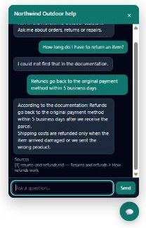
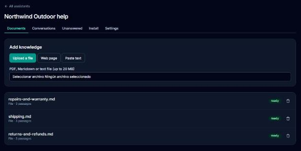
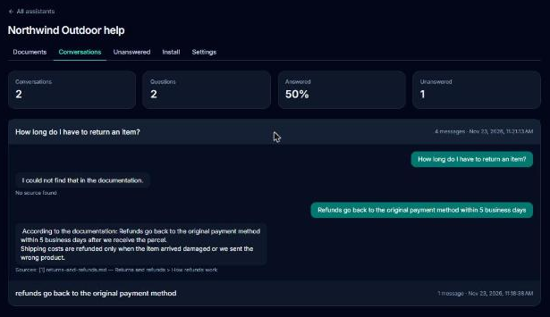
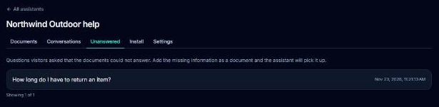

# RAGDesk Web

[](https://github.com/jesus1244/ragdesk-web/actions/workflows/ci.yml)


The front end of **RAGDesk**: an admin panel where a business uploads its documents and watches what
visitors ask, plus a **dependency-free chat widget** it embeds on its own website with one `<script>`
tag. Answers stream in live and cite the passage they came from.

> Backend: [ragdesk-api](https://github.com/jesus1244/ragdesk-api) (FastAPI · PostgreSQL + pgvector · Claude)

| The widget on a website | Documents being indexed |
| --- | --- |
|  |  |

| Conversations and the source behind each answer | Questions the docs could not answer |
| --- | --- |
|  |  |

## What's in it

**Admin panel (Angular 22)**

- **Auth**: register and sign in with JWT and **silent refresh**. One shared refresh request serves
  any burst of 401s, which matters with rotating refresh tokens. Route guards and safe `returnUrl`.
- **Assistants**: create, rename, set a welcome message, add guidance, restrict the websites that
  may embed the widget, delete.
- **Documents**: upload PDF, Markdown or text, add a web page by URL, or paste text. The list
  polls while the background worker is indexing and offers retry on failure.
- **Conversations**: answer rate, transcripts, and **which source backed each answer**.
- **Unanswered questions**: what visitors asked that the documents could not answer, so the owner
  knows what to write next.
- **Install**: the exact `<script>` tag to paste, with a copy button.

**Embeddable widget (`src/widget/`)**

- One file, **about 3 kB gzipped**, no framework and no dependencies. CI fails above 20 kB.
- Runs in a **Shadow DOM**: the host page cannot restyle it and it cannot leak styles.
- Reads the answer as a stream (`fetch` plus an incremental Server-Sent Events parser, tested with
  events split at arbitrary points) and lists the sources under each answer.
- Keyboard and screen-reader friendly: labelled controls, `role="log"`, `Esc` to close.
- Sends no cookies and no secrets. It only knows the assistant's public key.

## Embed it

```html
<script src="https://YOUR-HOST/widget.js" data-bot="bot_xxxxxxxx" defer></script>
```

The API is assumed to live on the same origin as the script; set `data-api="https://api.example.com"`
to point somewhere else. Try it locally with `public/widget-demo.html?bot=<public key>`.

## Security decisions

- **Answers are untrusted data.** The widget builds every node with `textContent`. ESLint bans
  `innerHTML`, `outerHTML` and `insertAdjacentHTML` in the whole codebase, and a test proves that
  HTML inside an answer is displayed as text.
- Tokens live in `localStorage` (guarded by try/catch) and are refreshed once per expiry; no other
  personal data is stored. The widget stores only a random visitor id.
- No secrets in the bundle. The same-origin `/api` proxy (dev server and nginx) means no CORS
  configuration is needed for the admin panel.
- nginx serves `widget.js` with a short cache and `Access-Control-Allow-Origin: *` (it is public
  code), and turns proxy buffering off so streamed answers are not held back.

## Stack and why

| Concern | Choice |
| --- | --- |
| Framework | Angular 22: zoneless, standalone, signals, Signal Forms |
| Styling | Tailwind 4 with a few design-system primitives (`.card`, `.input`, `.btn-*`) |
| Tests | Vitest through `ng test`, `HttpTestingController`, jsdom |
| Quality | ESLint (angular-eslint with template accessibility rules), Prettier, strict TypeScript |
| Widget build | esbuild, a single IIFE file |
| Delivery | Multi-stage Docker build to unprivileged nginx |

## Run it

```bash
npm ci
npm start                 # http://localhost:4200, proxies /api to localhost:8000
```

You need the API running (see its README). With its demo seed (`uv run ragdesk-seed-demo`) you get
an assistant with sample documents and no sign-up flow to walk through.

```bash
npm run build             # builds the widget, then the app
npx ng test --watch=false
npx ng lint
docker compose up --build # nginx on http://localhost:8080, API at host.docker.internal:8000
```

## Project layout

```
src/app/
  core/        auth (tokens, interceptor, guards), http helpers, toasts
  shared/      icons, field errors, copy button, pipes
  layout/      the signed-in shell
  features/    auth, bots, sources, insights
src/widget/    the embeddable widget (sse.ts, api.ts, widget.ts, main.ts)
deploy/        nginx template
```

## Engineering standards

- [`AGENTS.md`](AGENTS.md) has the short always-on rules; per-topic rules (components, HTTP, accessibility,
  widget security, testing, git) are generated from `scripts/gen-steering.mjs` into
  `.claude/rules/`, `.github/instructions/` and `.kiro/steering/`, so Claude Code, Copilot and Kiro
  follow the same guidance.
- Small commits, one feature each, tests with the feature. `git log` reads as the build-up of the
  project.
- A regression test exists for the bug found while running the app for real: assistant tabs that
  were missing from the router (`app.routes.spec.ts`).

## License

MIT
